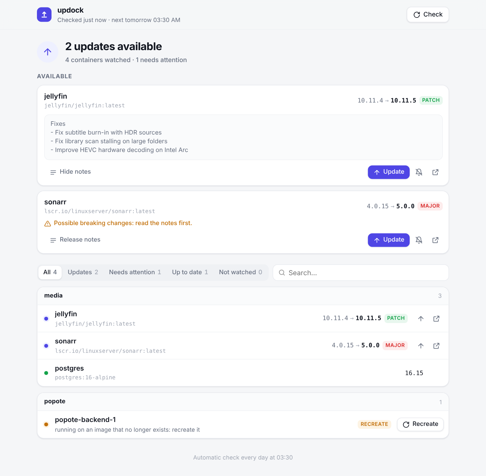
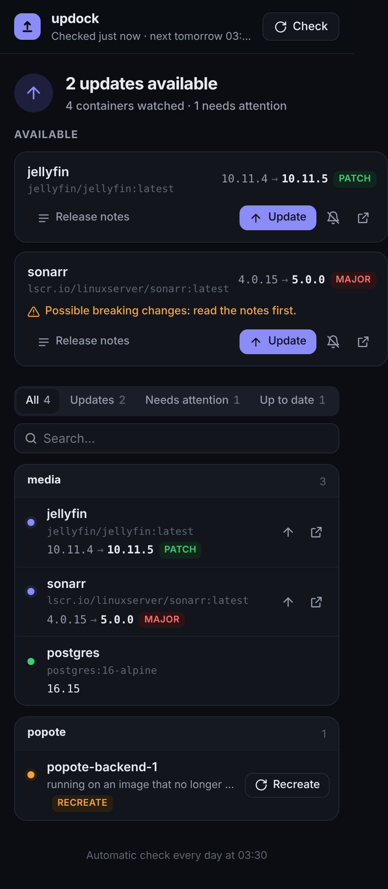

# updock

> **What's updock?** Real releases for your Docker containers, one tap to update.

Your containers run on `latest`, so every update checker you've tried tells you
*"a new image is available"* every other day: same version, rebuilt image. updock
works out the **actual version** inside each image, checks it against the
project's **GitHub releases**, and only bothers you when there is a real new
release. Then you update (or roll back) from your phone.

<p align="center">
  
  &nbsp;
  
</p>

## Features

- **Real versions, not digests.** `10.11.4 → 10.11.5 · patch`, `4.0.15 → 5.0.0 · major`,
  even for images pinned to `latest`. Rebuilds without a new version are ignored.
- **Versions you can trust.** Image labels lie sometimes (an Ollama image says
  `24.04`: that's its Ubuntu base). updock cross-checks every label against the
  project's real GitHub release tags, and falls back to release dates.
- **Release notes where you decide.** An excerpt in the notification and in the
  interface, plus a warning when they mention breaking changes or a migration.
- **One-tap updates from ntfy.** Notifications carry **Update**, **Notes** and
  **Ignore** buttons, protected by signed, single-use, expiring links.
- **Safe updates.** Only the one service is pulled and recreated, with the compose
  files it was started with. updock waits until it is running and healthy, and
  offers a **Roll back** to the previous image.
- **A web interface** (phone first, light and dark): updates on top, every
  container grouped by compose project, filters, search, live progress,
  *update all* (majors excluded), *recreate* for containers left on a deleted
  image, *check now*.
- **No surprise majors.** A tag like `postgres:16-alpine` stays on 16.x;
  changing major is your call, in your compose file.
- **Small.** One Python file with no dependencies, one HTML page. English and French.

## Quick start

```yaml
services:
  updock:
    image: ghcr.io/lguerard/updock:latest
    container_name: updock
    environment:
      - TZ=Europe/Paris
      - UPDOCK_NTFY_TOPIC=pick-a-long-random-topic   # openssl rand -hex 16
      - UPDOCK_PUBLIC_URL=http://my-server:8099      # how your PHONE reaches updock
      - UPDOCK_SECRET=change-me                       # openssl rand -hex 32
    volumes:
      - /var/run/docker.sock:/var/run/docker.sock
      - ./data:/data
      - /opt/stacks:/opt/stacks:ro    # your compose files, AT THE SAME PATH
    ports:
      - "8099:8099"
    restart: unless-stopped
```

1. Subscribe to your topic in the [ntfy](https://ntfy.sh) app.
2. `docker compose up -d`, then open `http://my-server:8099`.
3. That's it: updock checks every night at 03:30 and right after it starts.

> **Mount your compose folders at the same path.** To update a service, updock
> runs `docker compose pull` and `up -d` with the compose files recorded in the
> container's labels (absolute host paths). Those files, and anything they refer
> to with a relative path, must be visible inside updock at the very same path.
> Read-only is enough.

## How a version is worked out

For the image that is running and the one its tag points to now:

1. **`<IMAGE>_VERSION` environment variable** (`PG_VERSION`, `VALKEY_VERSION`,
   `NGINX_VERSION`…): set by official images, exact.
2. **`org.opencontainers.image.version` label**, kept only if it matches a real
   release tag of the project on GitHub.
3. **The newest stable GitHub release published before the image was built.**

The GitHub repository comes from the `org.opencontainers.image.source` label,
from a built-in table for images whose label points to a packaging repository
(Jellyfin, Immich, Frigate…), or from your `updock.github` label.
linuxserver.io's `-lsNNN` suffix is set aside: a new `-ls` build of the same
upstream version is a rebuild, not a release.

The registry is asked with a `HEAD` request first, which does not count against
Docker Hub's anonymous pull limit. GitHub answers are cached for 6 hours (the
unauthenticated API allows 60 requests an hour; set `UPDOCK_GITHUB_TOKEN` if you
watch a lot of containers).

## Configuration

| Variable | Default | |
|---|---|---|
| `UPDOCK_NTFY_TOPIC` | *(empty)* | ntfy topic for notifications. Empty = no notifications (web interface only). |
| `UPDOCK_NTFY_URL` | `https://ntfy.sh` | Your own ntfy server, if you have one. |
| `UPDOCK_NTFY_TOKEN` | *(empty)* | ntfy access token, for a protected topic. |
| `UPDOCK_PUBLIC_URL` | **required** | Address your phone uses to reach updock when you tap a button: VPN name/IP (Tailscale, WireGuard…) or LAN IP. |
| `UPDOCK_SECRET` | **required** | Signs the notification buttons. `openssl rand -hex 32`. |
| `UPDOCK_CHECK_AT` | `03:30` | Check time(s), local time (`TZ`). Several: `03:30,13:00`. |
| `UPDOCK_CHECK_ON_START` | `true` | Also check when the container starts. A release is never notified twice. |
| `UPDOCK_UI_PASSWORD` | *(empty)* | Password for the web interface (HTTP Basic). |
| `UPDOCK_LANG` | `en` | `en` or `fr`, for notifications and the interface. |
| `UPDOCK_GITHUB_TOKEN` | *(empty)* | GitHub token **with no scope at all**: raises the API limit to 5000 requests/h. |
| `UPDOCK_NOTIFY_REBUILDS` | `false` | Also notify rebuilds with no new version. |
| `UPDOCK_PORT` | `8099` | Port of the web interface and buttons. |

Container labels:

| Label | |
|---|---|
| `updock.enable=false` | Never watch this container. |
| `updock.github=owner/repo` | Read releases from this GitHub repository. |

To check right now from a shell: `docker exec updock python3 /app/updock.py --check`.

## What updock never does

- Change a tag (`v3` → `v4`, `16-alpine` → `17-alpine`): edit your compose file.
- Touch images pinned by digest (`image@sha256:…`) or built locally (`build:`).
- Update anything by itself: it only acts when you tap.

## Security

updock needs the Docker socket **with write access** to recreate containers:
that is root on the host. Keep it private.

- **Never expose port 8099 to the Internet** (no public reverse proxy, no tunnel).
  Reach it over your LAN or a VPN.
- Notification buttons are HMAC-signed links, single-use, valid 7 days.
- The web API only answers requests carrying an `X-Updock` header. A page from
  another site cannot send one without a CORS preflight, which updock never
  grants: visiting a malicious page cannot trigger an update.
- Set `UPDOCK_UI_PASSWORD` if other people use your network.
- On ntfy.sh a topic is public to whoever knows its name: pick a long random one,
  or reserve it with an account and use `UPDOCK_NTFY_TOKEN`.

## Development

```sh
python3 updock.py --selftest     # dependency-free tests
python3 updock.py --check        # one check, then exit
```

The image is built and published by GitHub Actions: `main` → `:edge`,
tag `v1.2.3` → `:1.2.3`, `:1.2`, `:1`, `:latest`.

## License

[MIT](LICENSE)
